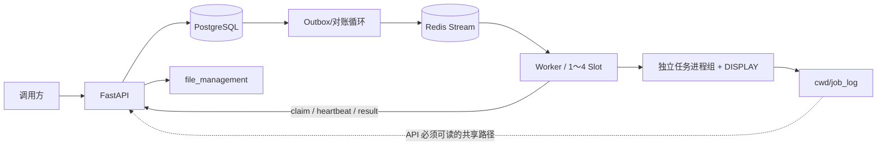

# 整体架构与运行契约

更新：2026-10-18；以当前源码为准。三个仓库按同级目录检出，vnc_build 是原 vnc_builder 的整理后名称。

## 组件与数据流

PostgreSQL 是权威存储；Redis 只提供通知。Task 保存 command/cwd、状态、超时、Worker/session/Slot 归属、执行时间和 job_info；Worker 保存注册 Slot 与租约快照；OutboxEvent 保存投递重试和通知 generation。generation 不是执行轮次。

## 授权和去重

创建任务与 Outbox 同事务提交。调度器先 XADD 再记 sent_at，崩溃可能重复通知。Worker 的每个 Slot 是独立 consumer，通过 XREADGROUP 读取新消息；API 在 claim 中锁 Worker 与 Task，校验有效 session/租约、注册 Slot 和占用状态。queued 任务只能授权一次；同归属的 running 任务可以返回原授权，处理响应丢失。

授权去重不等于保证执行完成：授权后、启动进程前崩溃不会自动重跑。长期 queued 的通知可以补投，已授权任务不会因 PEL 恢复再执行。Redis Stream 当前不自动裁剪。

## 状态和生命周期

| 触发 | 行为 |
| --- | --- |
| 正常执行 | queued → running → succeeded / failed |
| 排队取消 | queued → cancelled |
| 执行中取消 | running → cancel_requested → cancelled |
| 到达 deadline | running → timeout_requested → timed_out |
| deadline + 60 秒无结果 | 非终态执行兜底 timed_out，受对账周期影响 |
| 租约过期 | 清 Worker 展示快照，任务等待结果；本地 Worker 会停止并清理 |
| 强制注销/新 session 接管 | 未完成旧执行归 unknown，不重跑 |
| 正常 shutdown | 仍未确认结果的执行也归 unknown |

终态幂等返回，不允许迟到结果覆盖。非终态结果校验任务归属，不要求当前租约有效；取消状态只接受 cancelled，超时状态只接受 timed_out。Worker 收到结果冲突后查询 API 并协调终态。

## Worker 和图形环境

Worker 同时运行心跳、桌面恢复和各 Slot 消费循环。Slot 经历 idle/reserved/running/cleaning/reporting/recovering/error；cleanup_confirmed 为本地隔离条件，不是 HTTP 字段。桌面健康依赖 VNC 进程及 xset q，不能证明 GNOME 未锁屏。恢复循环不停止正在执行任务的桌面。

任务继承当前账号环境并覆盖 DISPLAY；create_subprocess_exec 使用独立 session/进程组。正常结束也检查并清理子进程，先 TERM 再 KILL。自行 setsid/daemonize 的程序不在保证范围；systemd KillMode=control-group 提供服务停止时的额外清理。

VirtualGL 为特定 OpenGL 应用提供渲染重定向；Worker 不安装/配置 GPU 驱动，不强制给所有任务或 GNOME 包裹 vglrun。Xorg :0、GLX/EGL 和 GPU 权限由部署阶段准备。

## 日志上传

Worker 写 stdout_YYYYmmdd-HHMMSS.log 与 stderr_YYYYmmdd-HHMMSS.log。结果包含路径；API 先提交终态及空 ID，再读取文件并同步上传，成功回填 stdout_id/stderr_id。配置 VNC_FILE_MGMT_URL 为空则跳过。占位协议为 POST 配置 URL、multipart 字段 file、响应 {"id":"..."}。

API 需要实际访问回报路径；多机器上路径字符串相同不表示文件共享。容器部署需要正确挂载。上传失败不影响终态、不补传。单文件 HTTP 超时 60 秒，Worker API 请求超时 10 秒，终态可在文件 ID 回填前被查询到。

## 已知实现限制与验证边界

- initialize 直接 await ensure；create 返回非零时可能在检查健康桌面前退出，部分启动目标尚存在边界缺口。
- 日志名仅精确到秒，同 cwd 的并发/快速连续任务可能重名并覆盖。
- 任务后将进程清理与桌面健康合并为 cleanup_confirmed；桌面异常可能触发无法自动解除的隔离。
- 新 Slot 先加入本地列表再刷新注册；注册失败后的重试恢复路径需要专项验证。
- 文件上传成功/失败、部分启动及新 Slot 补齐缺少对应专项测试；不能把实施计划中的验收项当作已经全部验证。
- 真实 CentOS 7、GNOME 多会话、VirtualGL/GPU、Squish 和 AUT 仍需按 acceptance.md 实测。

本次仅整理交付结构与文档，不修复上述业务实现问题。
